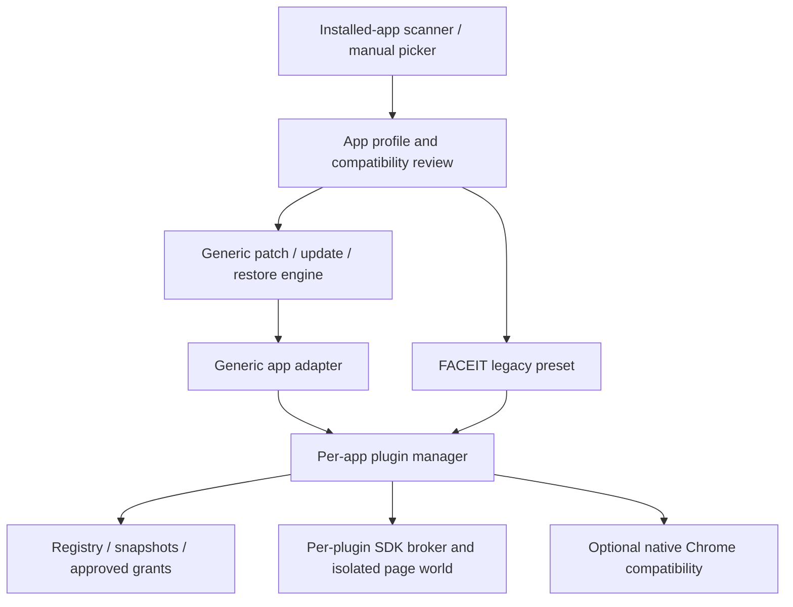

# Architecture

BridgeKit has two separate desktop surfaces: the app patcher selects/qualifies installations; each patched app hosts its own independent plugin manager.

app-scanner.cjs discovers bounded install locations and reads install records. A worker keeps discovery/hash/fuse work off the picker UI thread. app-inspection.cjs resolves packed main entries, hashes artifacts and reads integrity fuse state. It never executes detected app code.

patch-engine.cjs owns profiles, closed-app checks, staged sidecars, backup/ownership records and exact restore. archive.cjs handles nested entries and CJS/ESM wrappers. Native filesystem access avoids Electron treating inspected ASAR files as virtual directories. The FACEIT preset keeps existing receipts/paths and known hashes.

runtime/app-profile.cjs validates IDs, hashes and explicit origin/local-page policies. adapters/generic.cjs connects the existing manager to those pages, uses per-app data and defaults native mode off. Source integrations may use createPluginManager directly.

The plugin registry/controller/broker layers remain app-independent. Sidecar apps metadata keeps app-specific packages out of unrelated bundled discovery and rejects incompatible direct imports. Generic profiles do not auto-enable bundled defaults.

The trusted picker IPC authenticates exact WebContents/main frame/entry URL and exposes only discovery, selection and reviewed operations. Plugins cannot invoke it. SDK panels remain sandboxed, Node-disabled and capability-checked; isolated worlds share the app DOM. Native compatibility remains partial.

Bridge/ElectronBridge namespaces are retained where needed for existing data. Renaming or adding a general patcher does not migrate FACEIT's installation or settings.

Local companion panels may use a hidden sandboxed Bridge-owned workspace when no supported app parent exists. It has its own persistent session, no Node or preload, and no app-page grants. The fallback excludes SDK content/DOM/style/script/addon-management capabilities and native host/content permissions; it is not a general bypass of page qualification.

Companion SDK page.info may use a trusted main-process metadata callback to return title/URL for an observed profile-approved app window. It is grant checked, excludes offscreen/closed/unapproved pages and rechecks the source each call. DOM/style/script operations never use this fallback.
