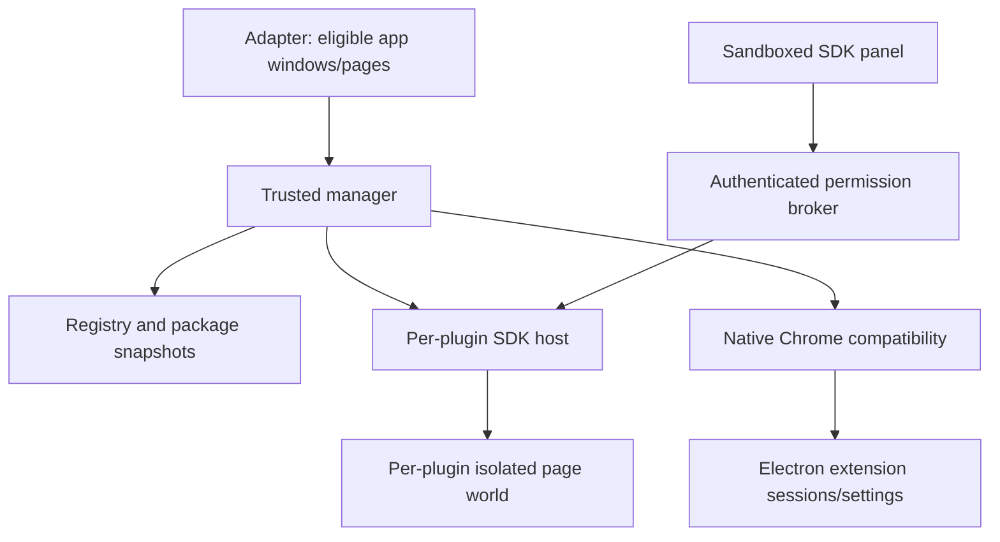

# Architecture

App integration, trusted management and packages are separate.

## Registry and lifecycle

registry.cjs inspects identities, manifests, containment and fingerprints, storing grants/enabled states separately from runtime status. package-import.cjs stages snapshots/ZIPs before review. normalize-package.cjs adapts copied native packages. plugin-controller.cjs serializes lifecycle and records errors/reload needs.

Management is independent of every plugin. Manager IPC authenticates its exact WebContents, frame and entry URL. Plugin panels cannot call manager operations directly.

## SDK

host.cjs binds explicit packages to eligible app windows. Its preload exposes named operations, not ipcRenderer. Brokers check capabilities; each package has a separate channel and persisted world ID.

page-api.cjs checks parent preferences, approved page state and navigation generation. Isolated worlds share the DOM: they do not protect page data from granted scripts or isolate CPU usage. HTML insertion is sanitized; approved bundled scripts have broader DOM/browser access without provided Node/Electron.

## Native

chrome-addons.cjs coordinates persistent sessions through Electron and the vendored compatibility library. It owns settings windows, supports selected tab/window operations and protects app windows from removal. chrome-permissions.cjs seeds compatibility reporting from approved grants.

Chromium behavior, API compatibility and grant reporting are different layers. A positive contains result does not implement a missing API. MAIN-world hooks may need reload to remove.

## Adapter/installer

Adapters choose eligible windows/pages without plugin identities. The separate FACEIT installer verifies builds, stages owned runtime/bootstrap files, records ownership and preserves the original archive. See [patching](patching-faceit.md).

The persistent ElectronBridge namespace is retained. Branding the project BridgeKit does not migrate storage or IPC.
